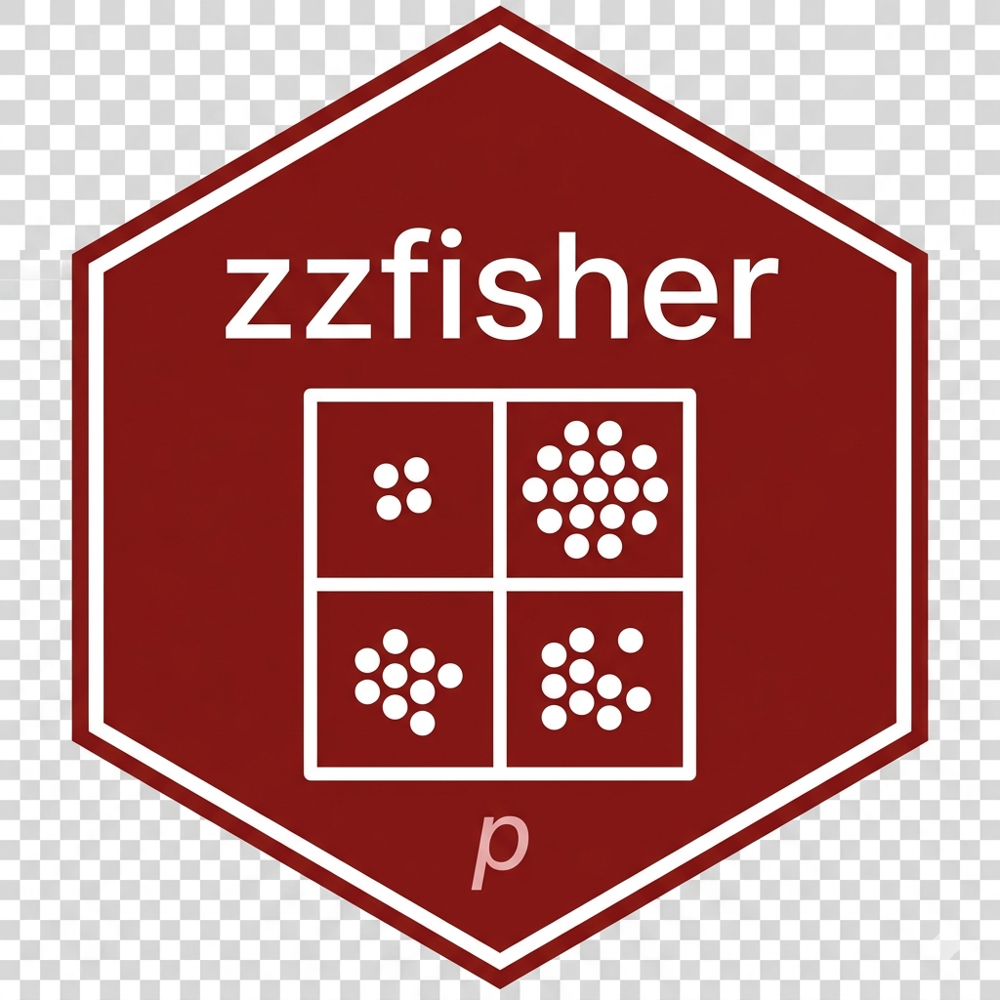

# zzfisher <a href="https://github.com/rgt47/zzfisher"></a>

Multiple algorithmic implementations of Fisher's exact test for
r x 2 contingency tables, with first-generation kernels for r x c
tables and r x c x k tables. Includes tree-based (mode-centric
traversal with pruning) and network-based (state-space enumeration
with Vandermonde bulk-sum) approaches in pure R, C, and C++. Also
includes exact power and sample-size calculation for the 2 x 2 test.

## Installation

### From source (development version)

Requires a C/C++ compiler toolchain (Rtools on Windows, Xcode
Command Line Tools on macOS, `r-base-dev` on Debian/Ubuntu).

```r
# install.packages("pak")
pak::pak("path/to/zzfisher")
```

Or with devtools:

```r
# install.packages("devtools")
devtools::install("path/to/zzfisher")
```

Or from the command line:

```bash
R CMD build path/to/zzfisher
R CMD INSTALL zzfisher_*.tar.gz
```

### From GitHub

```r
pak::pak("rgt47/zzfisher")
```

## Usage

Each test function takes a single argument `dat`: a table of
whole-number, non-negative counts (an r x 2 or r x c matrix, or an
r x c x k array). It returns an `htest` object with components
`p.value`, `alternative` (always `"two.sided"`), `method`, and
`data.name`. Input containing `NA`, negative, fractional, or
infinite values is refused with an error.

```r
library(zzfisher)

dat <- matrix(c(1, 4, 3, 5,
                2, 3, 1, 4), ncol = 2)
dat
#>      [,1] [,2]
#> [1,]    1    2
#> [2,]    4    3
#> [3,]    3    1
#> [4,]    5    4

tree_memo(dat)$p.value
#> [1] 0.9306159
tree_dp(dat)
tree_dp_cpp(dat)
net_dp_cpp(dat)
```

For r x c and r x c x k input, every dispatcher except
`net_sweep_cpp()` (which has its own r x c kernel) currently routes
to the same shared first-generation kernels.

### Exported functions

**Tree-based** (mode-centric traversal with pruning):

- `tree_memo()` -- Pure R reference implementation
- `tree_memo_c()` -- C99 port with dynamic-programming subtree bounds
- `tree_s4_c()` -- C99 with mode-path dominance pruning (S4), no
  memoization
- `tree_memo_cpp()` -- C++ port with `std::unordered_map`
- `tree_dp()` -- Pure R with constrained suffix-max DP
- `tree_dp_cpp()` -- C++ with constrained suffix-max DP

**Network-based** (state-space enumeration):

- `net_vander_cpp()` -- C++ with Vandermonde bulk-sum pruning
- `net_dp_cpp()` -- C++ with constrained suffix-max DP
- `net_sweep_cpp()` -- C++ state sweep with prefix-class aggregation

**Stratified test:**

- `net_ci_cpp()` -- Exact test of conditional independence of rows
  and columns given the layer, for an r x c x k array (a different
  hypothesis from the no-three-way-interaction test used by the
  r x c x k arms of the other functions)

**Diagnostics:**

- `tree_memo_profile()` -- C++ tree traversal returning an `htest`
  with a `$profile` list of counters attached. In a default build it
  errors; it requires rebuilding with `PROFILE_V4` enabled in
  `src/Makevars`.

**Power and sample size** (2 x 2 tables):

- `fisher_power()`, `fisher_power_fast()` -- power, or the sample
  size for a target power
- `fxpower()`, `fxpower_r()` -- power with unequal group sizes
  (compiled and pure-R reference)
- `ss_fxpower()`, `ss_fxpower_fast()` -- sample size with unequal
  groups
- `power_table()`, `ss_table()` -- power and sample-size grids across
  allocation ratios

## Limitations

The limits differ by function (checked against version 0.9.2):

- Maximum 20 rows (`MAX_ROWS`) in `tree_memo_c()`, `tree_s4_c()`,
  `tree_memo_cpp()`, `tree_dp_cpp()`, `net_dp_cpp()`, and
  `net_vander_cpp()`.
- Maximum total cell count of 10,001 in `tree_memo_cpp()` and
  `tree_memo_profile()`, and 10,000 in `tree_dp_cpp()`.
- Maximum total cell count of 1,020 in `net_dp_cpp()` and
  `net_vander_cpp()`, above which their binomial products overflow a
  double.
- The pure-R functions have no fixed limits but become slow on large
  tables.
- The test functions compute only the two-sided p-value.

## License

GPL (>= 3)
